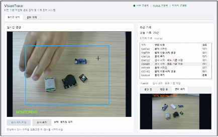
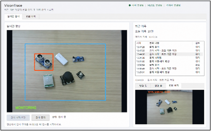
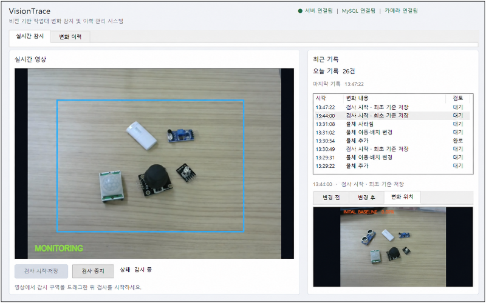
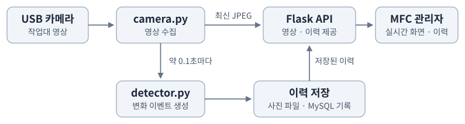
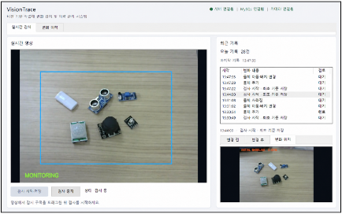
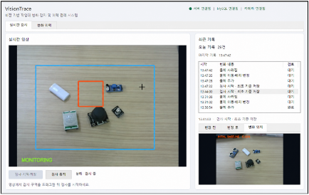

# VisionTrace

OpenCV로 작업대 위 물체의 변화를 감지하고 이력을 남기는 시스템입니다. 2명이 함께 만들었고, 이 저장소에는 제가 맡은 카메라 연결과 변화 감지 코드만 올렸습니다.


| 손이 움직이는 동안 (기록 대기) | 움직임이 멈춘 뒤 (물체 추가로 기록) |
|:---:|:---:|
|  |  |

## 프로젝트 소개

- 기간: 2026.10.14 ~ 2026.10.15
- 인원: 2명 (저: 카메라·변화 감지 / 팀원: MFC 화면·DB)

감시할 영역을 지정하면 기준 영상과 현재 영상을 비교해 물체가 추가됐는지, 사라졌는지, 옮겨졌는지 판단합니다.
움직임이 멈춘 뒤에 변경 전후 사진을 저장하고, 관리자는 MFC 화면에서 이력을 확인합니다.

<p align="center">
  
</p>

## 구조



## 맡은 부분

### 카메라 연결 (`camera.py`)

OpenCV `VideoCapture`로 USB 카메라를 엽니다. 윈도우에서 카메라 번호로 열 때는 DirectShow를 먼저 쓰고, 안 되면 Media Foundation으로 다시 시도합니다. 첫 프레임이 들어와야 연결된 것으로 봅니다.
수집은 별도 스레드에서 계속 돌고, 끊기면 2초쯤 뒤에 다시 연결합니다. 같은 스레드에서 0.1초 간격으로 감지 함수를 부르고, 감시 영역과 변화 위치를 그린 영상을 JPEG로 넘깁니다.

### 변화 감지 (`detector.py`)

```
흑백 → 가우시안 블러 → 밝기 보정 → 차영상 → 이진화 → 모폴로지 → 윤곽 검출
```

작은 영역은 면적 조건으로 거릅니다. 윤곽 픽셀 수 차이가 허용 범위 안이면 이동, 범위를 넘어 늘면 추가, 줄면 사라짐으로 봅니다.

### 언제 기록하는지

직전 프레임과 비교해서 움직이는 중인지 보고, 기준 영상과 비교해서 실제로 바뀌었는지 봅니다.

| 상황 | 결과 |
|---|---|
| 손이나 물체가 움직이는 중 | 기다림 |
| 움직임은 멈췄지만 기준 영상과 같음 | 기록 안 함 |
| 12번 연속 안정(약 1.2초), 변화 비율·면적 충족, 직전 기록 후 1.5초 지남 | 기록하고 기준 영상 갱신 |

| 물체 이동 | 물체 사라짐 |
|:---:|:---:|
|  |  |
| 이력에 `13:47:35 물체 이동·배치 변경` | 이력에 `13:47:42 물체 사라짐` |

## 문제 해결

### 작업 중 움직임에 따른 중복 감지
- **문제**: 기준 영상과 차이가 날 때마다 기록하면, 물체를 옮기는 동안 손과 물체의 움직임이 계속 잡혀 한 번의 작업이 여러 건으로 기록됨
- **해결**: 움직임은 직전 프레임과, 최종 변화는 기준 영상과 비교하도록 나눔. 12번 연속 안정(약 1.2초), 변화 비율·최소 면적 충족, 직전 기록 후 1.5초 경과를 모두 만족할 때만 기록하고 기준 영상을 갱신

### 조명 변화에 따른 오감지
- **문제**: 픽셀 차이를 그대로 비교하면 물체가 그대로여도 화면 밝기 변화나 작은 잡음이 변화로 잡힘
- **해결**: 밝기 차이의 중앙값으로 전체 밝기를 보정하고, 가우시안 블러와 모폴로지로 잡음 제거. 최소 면적과 변화 비율 조건도 적용

### USB 카메라 연결 실패와 끊김
- **문제**: 카메라가 열리지 않거나 감시 중 연결이 끊기면 영상과 감지가 같이 멈춤
- **해결**: 카메라 백엔드를 차례로 시도하고 첫 프레임으로 연결을 확인. 끊기면 자원을 정리하고 약 2초 뒤 다시 연결하며 상태 메시지 표시

## 파일 구성

```
src/visiontrace/
├── camera.py     # 카메라 연결, 영상 수집 스레드, 감지 주기
└── detector.py   # 움직임·변화 판단, 추가/사라짐/이동 구분
```

`camera.py`는 팀원이 만든 사진 저장 모듈(`events.py`)을 불러 쓰기 때문에 이 저장소만으로는 실행되지 않습니다.

사용 기술: Python, OpenCV, threading (팀 전체로는 Flask, C++ MFC, MySQL)

<!-- 시연 영상 링크 넣을 곳 -->
